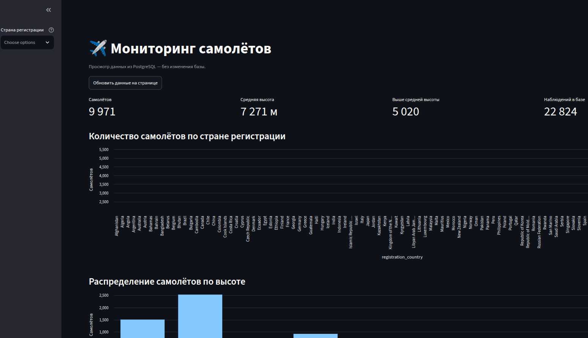

# ✈️ Мониторинг самолётов

Проект собирает данные о воздушных судах из **OpenSky API**, сохраняет их в **PostgreSQL** и показывает в интерактивном интерфейсе на **Streamlit**.

## Возможности

- Загрузка и хранение данных о самолётах в PostgreSQL.
- Просмотр списка самолётов в веб-интерфейсе.
- Фильтрация по стране регистрации.
- Сводные показатели: количество самолётов, средняя высота и число наблюдений.
- Графики количества самолётов по странам и распределения по высоте.

## Скриншот

Добавьте скриншот приложения в `docs/screenshots/dashboard.png`. После этого изображение отобразится в README:



## Технологии

- Python
- PostgreSQL
- Streamlit
- Poetry
- OpenSky API

## Запуск

### 1. Установите зависимости

```bash
poetry install
```

### 2. Настройте подключение к базе данных

Создайте в корне проекта файл `.env` и укажите параметры PostgreSQL:

```env
DB_NAME=имя_базы
DB_USER=пользователь
DB_PASSWORD=пароль
DB_HOST=localhost
DB_PORT=5432
```

> ⚠️ Не добавляйте файл `.env` в Git: он может содержать секретные данные.

### 3. Запустите интерфейс

```bash
poetry run streamlit run app.py
```

Откройте адрес, который Streamlit покажет в терминале, обычно:

```text
http://localhost:8501
```

## Структура проекта

```text
.
├── app.py              # интерфейс Streamlit
├── main.py             # загрузка данных проекта
├── src/
│   └── db_use.py       # работа с PostgreSQL
└── .streamlit/
    └── config.toml     # настройки Streamlit
```

## Скриншоты проекта

Сохраните изображения в папку `docs/screenshots/` и добавьте их в этот раздел, например:

```markdown

```